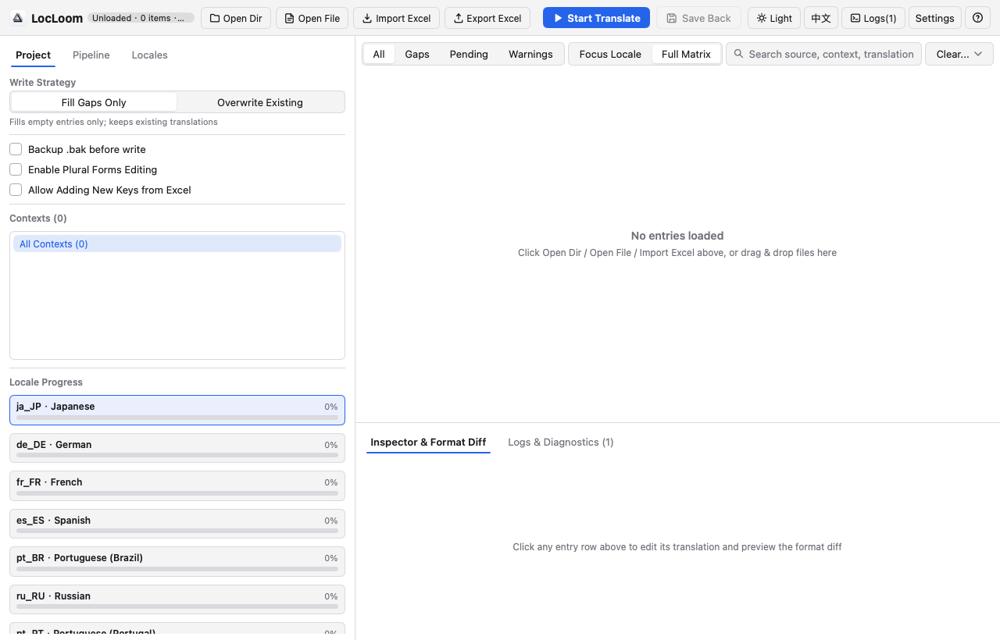

# LocLoom — Cross-Platform Lossless Localization Workbench

[English](README.md) | [简体中文](README.zh-CN.md)

---

**LocLoom** is a cross-platform, single-binary desktop and CLI localization workbench (`CGO_ENABLED=0`) built with Go and [`egoist/mygo`](https://github.com/egoist/mygo), supporting **macOS**, **Windows**, and **Linux**. Designed around lossless file preservation, it supports **8 built-in localization formats** (`Qt .ts`, `GNU Gettext .po/.pot`, `JSON i18n`, `Flutter .arb`, `Apple .xcstrings`, `Android strings.xml`, `.NET .resx`, and `XLIFF 1.2/2.0`), fills multi-language translations via a concurrent 10-source waterfall pipeline, exports multi-mode `.xlsx` review workbooks, and writes changes back **losslessly**.



## 1. Overview & Core Capabilities

- **8 Built-In Lossless Localization Formats**
  - **Qt Linguist (`.ts`)**: Surgical UTF-8 byte-offset XML patching preserving BOM, CRLF/LF, indentation, XML comments, `<!DOCTYPE TS>`, `<location>`, `<byte value="x..."/>`, and `<numerusform>` plural forms.
  - **GNU Gettext (`.po` / `.pot`)**: Preserves headers, translator/extracted comments, `msgctxt` context, `msgid_plural` / `msgstr[n]` plural forms, and `fuzzy` flags.
  - **JSON i18n (`.json`)**: Nested or flat key-value JSON with `{placeholder}` / `{{placeholder}}` protection and source-template backfilling.
  - **Flutter ARB (`.arb`)**: Preserves `@metadata` blocks, ICU placeholders, and `@@locale`.
  - **Apple String Catalogs (`.xcstrings`)**: Multi-locale single-file catalog preserving `sourceLanguage`, `extractionState`, `variations`, and `state`.
  - **Android (`strings.xml`)**: Supports `values/strings.xml` and `values-<lang>/strings.xml` with `translatable="false"`, `<string-array>`, and `<plurals>`.
  - **.NET (`.resx`)**: Preserves XML schema headers, `resheader` metadata, `<data>` comments, and non-string resources.
  - **XLIFF (`.xliff` / `.xlf`)**: Supports both XLIFF 1.2 (`<trans-unit>`) and XLIFF 2.0 (`<unit>` / `<segment>`).
- **Context & Key-ID Safe Disambiguation**
  - Uniquely identifies entries by `(ID, Context, Source, Comment)` (`EntryKey`), ensuring identical strings across different contexts or key IDs never collide.
  - Automatically backfills readable source text from source templates (e.g., `en.json`, `values/strings.xml`, `Strings.resx`, `.pot`) for ID-keyed formats.
  - Isolates `.xlsx`-only rows by default to prevent injecting phantom entries; external rows are inserted only when **Append Missing** is explicitly enabled.
- **10-Source Concurrent Waterfall Pipeline**
  - Chains local and online providers in drag-and-drop customizable priority order: **Local `.xlsx` Glossary** → **Local Translation Memory (TM)** → **Google Translate (Web)** → **Microsoft Bing / Edge (Keyless / Azure)** → **LibreTranslate / Lingva (Keyless)** → **MyMemory (Keyless)** → **DeepL / DeepLX** → **OpenAI / Ollama-Compatible LLMs** → **Baidu Translate API** → **Niutrans API**.
  - Supports multi-locale concurrent scheduling, persistent local caching (`translation-cache.json`), and **HTTP / SOCKS5 proxies** (with optional TLS verification skip for self-signed gateways).
- **Placeholder & Whitespace Guard**
  - Automatically masks Qt (`%1`..`%99`, `%n`), printf (`%s`, `%d`, `%1$s`), ICU/template (`{name}`, `{{var}}`), and surrounding whitespace before sending text to remote MT/LLM providers, flagging anomalies with `[⚠]`.

## 2. Cross-Platform Build & CLI Flags

### Build Commands (`CGO_ENABLED=0`)

```bash
# macOS (Apple Silicon / Intel)
CGO_ENABLED=0 go build -ldflags="-s -w" -o locloom .

# Windows (GUI executable without console window)
CGO_ENABLED=0 go build -ldflags="-s -w -H=windowsgui" -o locloom.exe .

# Linux
CGO_ENABLED=0 go build -ldflags="-s -w" -o locloom .
```

### Desktop Installers (`mygo.json`)

```bash
# Build native installers (.dmg, NSIS setup .exe, .deb, .rpm, .tar.gz)
go tool mygo build -platform darwin/universal,windows/amd64,linux/amd64
```

Prebuilt community installers do not yet carry commercial Apple Developer or Authenticode signatures. On first launch:

- **macOS (`.dmg`)**: Drag `LocLoom.app` into `/Applications`. If Gatekeeper reports the app is damaged or unverified, remove the quarantine attribute once and relaunch:

  ```bash
  sudo xattr -cr /Applications/LocLoom.app
  ```

  Alternatively, open **System Settings → Privacy & Security** and click **Open Anyway**.
- **Windows (`.exe` / `.zip`)**: If Windows SmartScreen shows *"Windows protected your PC"*, click **More info → Run anyway**.
- **Linux (`.deb` / `.rpm` / `.tar.gz`)**: Install with `sudo apt install ./locloom_*_amd64.deb` or `sudo rpm -Uvh ./locloom-*.rpm`, or extract the tarball.

### CLI Flags

| Flag | Description | Example |
| :--- | :--- | :--- |
| `-src <path>` | Initial localization directory or `.zip` archive to load on startup | `-src ./i18n/ts` |
| `-ts <path>` | Alias for `-src`: initial `.ts` directory or `.zip` path | `-ts ./i18n/ts` |
| `-xlsx <path>` | Initial `.xlsx` glossary/translation workbook to import on startup | `-xlsx ./glossary.xlsx` |
| `-theme <mode>` | UI theme override: `system` (default), `light`, `dark` | `-theme dark` |
| `-lang <mode>` | UI language override: `zh` (default), `en`, `auto` | `-lang en` |
| `-open-help` | Open the built-in usage guide modal on startup | `-open-help` |
| `-headless-render <png>` | Render a single UI frame to a PNG file and exit (smoke verification) | `-headless-render ./preview.png` |
| `-width <px>` | Initial window width (default `1280`) | `-width 1440` |
| `-height <px>` | Initial window height (default `820`) | `-height 900` |

```bash
# macOS / Linux example
./locloom -src ./translations -xlsx ./translations.xlsx -theme dark

# Windows PowerShell example
.\locloom.exe -src .\translations -xlsx .\translations.xlsx -theme system
```

## 3. Standard Workflow & Status Badges

1. **Load Any Supported Format**: Click **Open Dir** or **Open File** in the header (or drag and drop files, a folder, or a `.zip` onto the window). LocLoom auto-detects the format, displays the active format badge, and **Smart Project Sync** aligns enabled target locales with the loaded project.
2. **Import / Export `.xlsx`**: Drag and drop an `.xlsx` file or use the header buttons. Supports `Key ID`, `Context`, `Source`, `Comment`, and multi-locale columns (reference columns labeled `ref` / `参考` are skipped). Export modes include **All**, **Gaps Only**, **Pending Changes**, and **Warnings Only**.
3. **Configure Waterfall & Proxy**: Expand any of the 10 built-in provider cards in the **Pipeline** tab, toggle secret visibility, test connectivity, discover LLM models, and optionally configure HTTP/SOCKS5 proxies.
4. **Inspect, Translate Row & Save Back**: Switch between **Focus Locale** and **Full Matrix** (click any cell to target that locale), use Inspector power actions (**⚡ Translate Row**, **◀ Prev Gap**, **Next Gap ▶**, **Copy Src**, **Use Src**, **Reset Cell**), preview format-aware Before/After diffs, and click **Save Back (N)** with optional `.bak` backups or `*_updated.zip` output.
5. **Real-Time UI Language Switching**: Click **`[EN]` / `[中文]`** in the top-right header to toggle the entire workbench between English and Simplified Chinese on the fly, or pass `-lang <auto|zh|en>` on startup.

Status badges are strictly for UI preview and are **never** written to localization or `.xlsx` files:

| Badge | Meaning | Behavior |
| :--- | :--- | :--- |
| **`[Fill]`** | Fill Gap | Original entry is `unfinished` or empty; writes translation and removes `type="unfinished"` |
| **`[Over]`** | Overwrite | Shown only in Overwrite mode; replaces an existing finished translation |
| **`[Add]`** | Append Missing | Shown when Append Missing is enabled; inserts a new entry into the target `<context>` |
| **`[⚠]`** | Format Warning | Placeholder count (`%1` / `%n`), mask token, or trailing `\t` differs from the source text |

## 4. OS Configuration & Cache Paths

LocLoom follows standard OS application directories and supports **Portable Mode**:

| Platform | Configuration File (`config.json`) | Cache File (`translation-cache.json`) |
| :--- | :--- | :--- |
| **macOS** | `~/Library/Application Support/locloom/config.json` | `~/Library/Caches/locloom/translation-cache.json` |
| **Windows** | `%AppData%\locloom\config.json` | `%LocalAppData%\locloom\translation-cache.json` |
| **Linux** | `~/.config/locloom/config.json` | `~/.cache/locloom/translation-cache.json` |
| **Portable Mode** | If `config.json` exists alongside the executable, LocLoom reads and writes it there |

## 5. Multi-Format Engine Architecture

LocLoom's `internal/format` driver registry decouples the domain model (`internal/domain`), matrix planner (`internal/planner`), and desktop workbench (`internal/app`) from individual file syntaxes, enabling seamless lossless round-trips across all 8 localization ecosystems.
